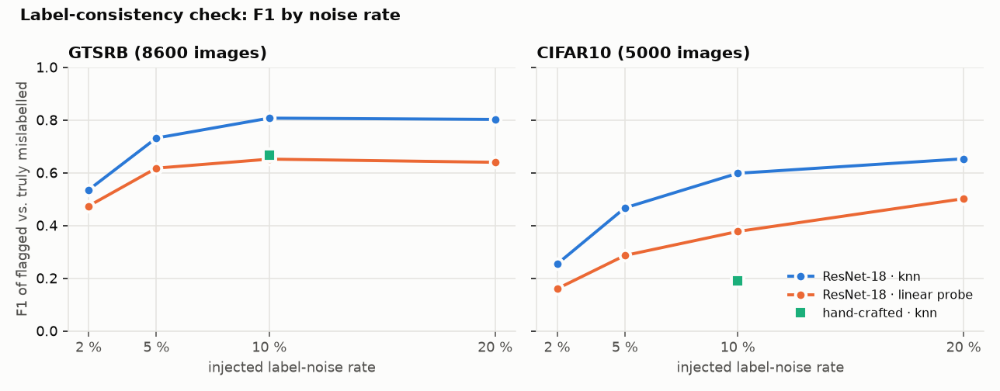
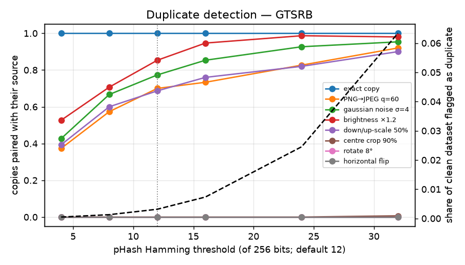
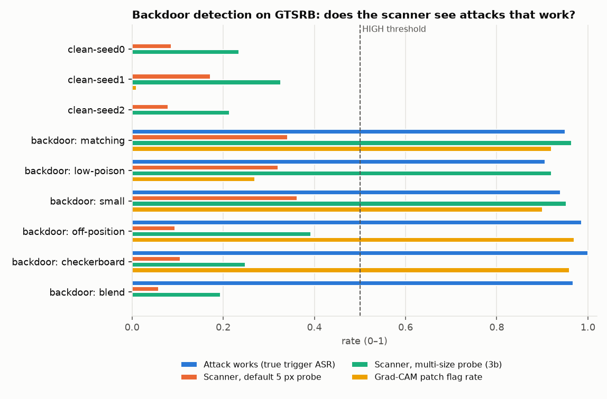
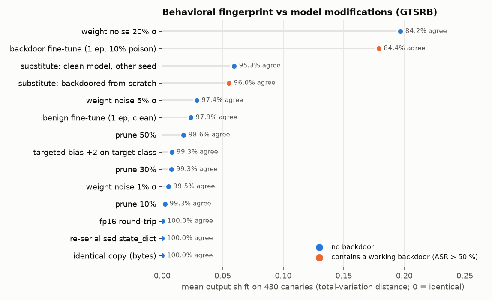

# VisionTrust: evaluation on real-world data

**Datasets**
- **GTSRB** (German traffic signs): 43 classes. Used for every experiment.
- **CIFAR-10**: 10 classes of natural images. Used for the data-side experiments (1, 1b and 2).

**Scope.** All numbers come from the platform's own code paths: `assurance/*`, called the way the dashboard calls them. Raw results are in `results/*.json`, tables in `results/*.md` and console output in `logs/`. [README.md](README.md) explains how to reproduce them.

## Summary

| Component | Works well | Fails / limits | Key number |
|---|---|---|---|
| **Label-consistency check** (ResNet-18 kNN) | Finds dirty-label poison and random label errors, and suggests the right label | Flags 2.6 % (GTSRB) / 7.6 % (CIFAR-10) of *correct* images; blind to blend and clean-label poison | 10 % noise: F1 0.81 (GTSRB), 0.60 (CIFAR-10) |
| **Duplicate detector** (pHash) | Exact and re-encoded copies; finds real redundancy (GTSRB video frames) | Crops, rotations and flips: 0 % detected; default threshold too strict | Re-encoded copies caught: 66–97 % at threshold 12, 82–100 % at 24 |
| **Trigger scanner** (5 px white probe) | No false alarms (3/3 clean models LOW); finds the right target and corner | **0 of 6 working backdoors rated HIGH** at the default; misses off-position, patterned and blended triggers | Corner backdoors: 29–36 % scanner ASR vs 91–95 % real ASR |
| **Trigger scanner, multi-size probe** (proposed, measured in exp 3b) | All 3 corner-patch backdoors → HIGH with correct target; clean models stay LOW (sizes ≤ 6 px) | Still blind to off-position, patterned and blended triggers | 0.92–0.96 ASR |
| **Grad-CAM patch rule** | Confirms a *given* patch trigger: 90–97 % of triggered images; 0–1 % false alarms on clean models | Needs the trigger location (confirms a candidate, does not discover it); weak at 1 % poison (27 %) | — |
| **SHA-256 fingerprint** | Every byte change detected | Also flags harmless re-serialisation of identical weights | 13/13 modified files detected |
| **Behavioral fingerprint** (canaries) | Graded signal separating re-encodings (TV ≈ 0) from substitutions (TV ≈ 0.06) | **Cannot see backdoors**: a backdoored model agrees with the reference as much as a clean retrain (96 % vs 95 %) | 430 canaries: benign edits ≥ 97.4 % agreement |
| **Provenance hash chain** | 11/11 in-scope tampering attacks detected, 30/30 trials each | 0/30 for tail truncation, appended forgery and full re-hash (no key, no anchor) | Verifying 10 k records: 0.12 s |

---

## Setup

- **Data ingestion.** Data goes through `assurance.datasets.load_torchvision`, which materialises stratified subsets as PNGs:
  - GTSRB train: 8,600 images, about 200 per class.
  - CIFAR-10 train: 5,000 images, 500 per class.
  - GTSRB test: 3,000 images, which the scanner and canary sets draw from.
- **Models.** TinyCNN at 32×32, trained for 8 epochs on the full GTSRB train split (26,640 images). Clean test accuracy is 95.1–96.1 % for every model. Models are loaded back through `assurance.model_loader` from a state_dict plus a sidecar file.
- **Backdoor target.** Class `1` (*Speed limit 30*) on GTSRB and `automobile` on CIFAR-10. Every attack is dirty-label BadNets-style poisoning.
- **Hardware.** 12-core CPU, no GPU.

---

## 1 · Label-consistency check against label noise (exp 1, 1b)

A random fraction of labels is flipped to another class. The check runs with its defaults: ResNet-18 features and a kNN vote with k = 10 and agreement ≥ 0.6.

| Noise | GTSRB precision | GTSRB recall | GTSRB F1 | CIFAR-10 precision | CIFAR-10 recall | CIFAR-10 F1 |
|---|---|---|---|---|---|---|
| 0 % (flag rate on clean data) | — | — | 2.6 % flagged | — | — | 7.6 % flagged |
| 2 % | 0.40 | 0.80 | 0.54 | 0.16 | 0.67 | 0.25 |
| 5 % | 0.66 | 0.82 | 0.73 | 0.35 | 0.70 | 0.47 |
| 10 % | 0.83 | 0.79 | **0.81** | 0.55 | 0.66 | **0.60** |
| 20 % | 0.93 | 0.70 | 0.80 | 0.76 | 0.57 | 0.65 |

- **The suggested label is right.** Among truly mislabelled images that were found, the check proposes the original label 97–98 % of the time on GTSRB and 93–97 % on CIFAR-10. A reviewer can usually accept the suggestion.
- **kNN beats the linear probe.** The probe finds slightly more errors but flags about 5× more correct images at 10 % noise (1.7–13× across noise levels). At 10 % noise its F1 is 0.65 against 0.81 (GTSRB), and 0.38 against 0.60 (CIFAR-10). kNN should stay the default.
- **The pretrained extractor matters.** Hand-crafted features reach F1 0.67 on GTSRB, a dataset of colour and shape, but only 0.19 on CIFAR-10. The offline fallback is not adequate for natural images.
- **Threshold trade-off.** At 10 % noise on GTSRB:
  - 0.6 gives precision 0.83 and recall 0.79.
  - 0.8 gives precision 0.97 and recall 0.57.
  - 0.4 gives precision 0.62 and recall 0.94.

  The full sweep is in `results/exp1_label_noise_*.md` and `figures/exp1_threshold_*.png`.
- **What the clean-data flags are.** I inspected the 32 most confident flags on each unmodified dataset by eye (`figures/exp1b_clean_flags_*.png`). Almost none are label errors:
  - **GTSRB:** the flags cluster in fine-grained, look-alike classes: speed limits 30↔20, 60↔80 and 50↔20, *No passing* ↔ *No passing > 3.5t*, and warning triangles whose pictograms ImageNet features don't resolve. There are also some nearly black frames.
  - **CIFAR-10:** the flags follow background and context, such as birds on grass (→ deer), animals on green (→ frog) and pickups (truck ↔ automobile).

  **The output is a review queue, not an automatic filter.**
- **Caveat: GTSRB numbers are optimistic.** GTSRB contains ~30 near-identical video frames per physical sign, so a mislabelled frame's neighbours are usually its own correctly labelled siblings. CIFAR-10, where images are independent, is the more representative estimate for typical data.

## 2 · Dataset scanner against poisoned data (exp 2, 2b)

### A. Backdoor poison in the training set

The table shows recall and precision of the default kNN check on the poisoned samples.

| Poison variant | GTSRB recall | GTSRB precision | CIFAR-10 recall | CIFAR-10 precision |
|---|---|---|---|---|
| White patch, relabelled, 1 % | 0.77 | 0.23 | 0.74 | 0.09 |
| White patch, relabelled, 5 % | 0.77 | 0.65 | 0.67 | 0.34 |
| White patch, relabelled, 10 % | 0.75 | 0.81 | 0.59 | 0.53 |
| Noise blend α = 0.15, relabelled, 5 % | **0.16** | 0.24 | **0.05** | 0.03 |
| Clean-label (target images stamped, labels correct), 2 % | 0.11 | 0.08 | 0.10 | 0.03 |

- **Patch poison is found well.** About three quarters of BadNets samples are flagged, and in 89–99 % of hits the check names the image's real source class. A stamped stop sign still looks like a stop sign.
- **More poison lowers recall, especially on CIFAR-10.** Recall drops from 0.74 at 1 % to 0.59 at 10 %, because poisoned images start to be each other's neighbours. Precision rises at the same time, because the clean-data false positives stay constant while the number of poisoned samples grows.
- **Blend poison defeats the check.** The shared noise pattern dominates the embedding, so poisoned images cluster together and vote for each other's (wrong) label.
- **Clean-label poison is invisible to it, by construction.** Its recall equals the clean-data flag rate, which means there is no signal at all. The labels are correct, so a label check cannot help.

### B. Duplicate flooding

150 transformed copies of real images were added per transform. The table shows the share of copies paired with their source image.

| Transform | GTSRB @12 | GTSRB @24 | CIFAR-10 @12 | CIFAR-10 @24 |
|---|---|---|---|---|
| Exact copy | 1.00 | 1.00 | 1.00 | 1.00 |
| PNG → JPEG q = 60 | 0.70 | 0.83 | 0.66 | 0.99 |
| Gaussian noise σ = 4 | 0.77 | 0.93 | 0.97 | 1.00 |
| Brightness × 1.2 | 0.85 | 0.99 | 0.83 | 0.98 |
| Down/up-scale 50 % | 0.69 | 0.82 | 0.15 | 0.95 |
| Centre crop 90 % / rotate 8° / horizontal flip | 0.00 | 0.00 | 0.00 | 0.00 |
| *Clean dataset flagged as duplicate* | 0.3 % | 2.5 % | 0 % | 0.02 % |

- **The default threshold of 12 (of 256 bits) is too strict.** At 24, recall on re-encoded copies rises to 82–100 %. CIFAR-10 still has essentially no false duplicates at that level.
- **What gets flagged in clean GTSRB is real redundancy.** 100 % (at threshold 12) and 99.5 % (at 24) of the reported pairs are frames of the same physical sign (exp 2b, checked against GTSRB track IDs). That is useful for train/test leakage audits, not a false alarm.
- **pHash is not invariant to crops, rotations or flips.** A duplicate flood that uses any of them gets through completely.

## 3 · Trigger scanner and Grad-CAM against trained backdoored models (exp 3, 3b)

Each attack was trained into a separate model. The scanner was run with its defaults: the target class is unknown and discovered automatically, with 90 and 300 test images.

| Model | Real attack ASR | Scanner (default) | Scanner ASR (n = 300) | Multi-size scan, 2–6 px (3b) | Grad-CAM rule |
|---|---|---|---|---|---|
| Clean, seed 0 / 1 / 2 | — | LOW / LOW / LOW | 0.09 / 0.17 / 0.08 | LOW (≤ 0.22) | 0.00 / 0.01 / 0.00 |
| 4 px white corner patch, 5 % | 0.95 | MEDIUM, correct target and corner | 0.34 | **HIGH 0.96** | 0.92 |
| Same, 1 % poison | 0.91 | MEDIUM, correct | 0.32 | **HIGH 0.92** | 0.27 |
| 3 px white corner patch | 0.94 | MEDIUM, correct | 0.36 | **HIGH 0.95** | 0.90 |
| 4 px white patch, off-position (row 4, col 14) | 0.99 | LOW | 0.10 | LOW 0.15 | 0.97 |
| 4 px checkerboard, corner | 1.00 | LOW | 0.11 | LOW 0.14 | 0.96 |
| Full-image noise blend α = 0.1 | 0.97 | LOW | 0.06 | LOW 0.16 | n/a |

- **No false positives, but also no HIGH verdicts.** Every backdoor here works on ≥ 91 % of test images, yet the default scan never reaches HIGH. For the three corner patches it did point at the correct target class and the correct corner, at MEDIUM.
- **Probe size is the main reason.** A 5 px probe over a 3–4 px trigger reaches only ~1/3 ASR; a probe of the right size reaches 0.92–0.96. Sweeping probe sizes of 2–6 px and taking the maximum turns all three into HIGH, with the correct target. The clean models stay LOW, at most 0.22. Adding an 8 px probe pushes one clean model to MEDIUM (0.33), because large white squares occlude the sign.
- **Outside the probe's threat model, detection fails.** That covers a trigger away from the 5 probed positions, a patterned trigger, and a blend trigger, even though those backdoors work on 97–100 % of images. Detecting them needs a sliding-window position search and trigger reverse-engineering (e.g. Neural Cleanse), not more of the same probe.
- **Grad-CAM is a strong confirmation signal.** With the real trigger stamped, the Explainability rule (heat on the patch > 2× the image mean, and the prediction flipped) fires on 90–97 % of images for 4 of the 5 patch attacks, and on 0–1 % for clean models. The weak case is the 1 %-poison model (0.27). It needs the candidate trigger location, so it complements the scanner rather than replacing it.

## 4 · Fingerprinting against model modifications (exp 4)

**Reference:** clean model (seed 0). **Canary sets** come from the test split: 1, 3 or 10 images per class, giving 43, 129 or 430 images. **TV** is the mean total-variation distance between softmax outputs on the canaries.

| Modification | Test accuracy | Backdoor ASR | SHA match | Agreement (k=1 / 3 / 10) | TV (k = 10) | Verdict |
|---|---|---|---|---|---|---|
| Identical copy | 0.960 | 0.00 | ✓ | 100 / 100 / 100 % | 0.000 | PASS |
| Re-serialised identical weights | 0.960 | 0.00 | ✗ | 100 / 100 / 100 % | 0.000 | REVIEW |
| fp16 round-trip | 0.961 | 0.00 | ✗ | 100 / 100 / 100 % | 0.000 | REVIEW |
| Prune 10 / 30 / 50 % | 0.957–0.963 | 0.00 | ✗ | ≥ 98.6 % | 0.002–0.018 | REVIEW |
| Weight noise 1 % / 5 % σ | 0.960 / 0.953 | 0.00 | ✗ | ≥ 97.4 % | 0.005 / 0.029 | REVIEW |
| Weight noise 20 % σ | 0.844 | 0.02 | ✗ | 79–85 % | 0.197 | ALERT |
| +2 bias on the target class | 0.957 | 0.01 | ✗ | 99.2–100 % | 0.008 | REVIEW |
| Benign fine-tune (1 epoch) | 0.958 | 0.00 | ✗ | 97.9–100 % | 0.024 | REVIEW |
| **Backdoor fine-tune** (1 epoch, 10 % poison) | 0.876 | **0.70** | ✗ | 77–85 % | 0.179 | ALERT |
| Substitute: clean model, other seed | 0.959 | 0.00 | ✗ | 95–98 % | 0.060 | REVIEW |
| **Substitute: backdoored model** | 0.954 | **0.95** | ✗ | 95–96 % | 0.055 | REVIEW |

- **SHA-256 catches everything, including harmless re-encodings.** Saving the *same* weights to a new file changes the hash, because `torch.save` embeds the archive name. On its own, SHA cannot tell "re-exported" from "replaced".
- **Behavior gives a graded signal.** Re-encodings sit at TV ≤ 0.0002. Light edits (pruning, small noise, fine-tuning) sit at 0.002–0.03. An independently trained model sits at 0.06. Heavily damaged models sit at 0.18–0.20.
- **The behavioral fingerprint does not detect backdoors.** A model with a 95 %-effective backdoor agrees with the reference as much as a clean model from a different seed. The canaries contain no trigger, so a backdoor doesn't show. The backdoor fine-tune only scores ALERT because it also cost 8 points of accuracy. Fingerprinting verifies *identity*; the trigger scanner has to cover *integrity*.
- **A targeted logit tamper is nearly invisible.** It agrees 99.3 % at TV 0.008, in the same range as 30 % pruning.
- **Canary-set size matters.** With 43 canaries (k = 1), every light edit reads 100 % and substitutions read 95–98 %. Use k ≥ 10 per class.

## 5 · Provenance chain against tampering (exp 5)

**Setup:** a 60-record chain created with `create_inference_record` on real test images, with 30 random trials per attack.

| Attack | Detected |
|---|---|
| Edit output, confidence, timestamp, input hash, model hash, preprocessing hash or nonce | 30/30 each |
| Delete a middle record · swap adjacent records · insert a forged record | 30/30 each |
| Edit a record and re-hash that record only | 30/30 |
| **Truncate the last 1–4 records** | **0/30** |
| **Append a correctly hashed forged record** | **0/30** |
| **Edit a record and re-hash all later records** | **0/30** |

- **In-model attacks are all caught.** Every attack an *unkeyed* hash chain is designed for is detected.
- **The three undetected attacks need a secret or an external anchor.** Anyone who can write the file can recompute SHA-256 values. Signing records (HMAC or Ed25519) and periodically anchoring the head hash outside the file would close all three.
- **Cost:**
  - Creating a record takes 62 ms, mostly re-hashing the 2.5 MB model file on every call. A large model would make that much slower, so cache the hash keyed on file mtime.
  - Verifying 10,000 records takes 0.12 s.

---

## Recommended changes, ranked by evidence

1. **Trigger scanner: sweep probe sizes 2–6 px** (take the maximum ASR). This is measured in exp 3b: 3/3 corner backdoors move from MEDIUM to HIGH, and there are 0/3 clean false alarms. It's a small change in `scan_backdoor`.
2. **Trigger scanner: add a sliding-window position sweep and non-white patterns**, and put trigger inversion on the roadmap. Off-position, patterned and blend backdoors are currently invisible (3/6 attacks).
3. **Duplicate detector: raise the default threshold from 12 to about 20–24.** Add a flip-invariant hash (hash the mirrored image too) and an embedding-based near-duplicate pass for crops and rotations.
4. **Label check: present it as a review queue.** Show the suggested label and per-class flag rates, keep kNN as the default, and warn when the fallback extractor is used. A stronger or higher-resolution extractor such as DINOv2 or CLIP is the obvious next step for low-resolution natural images.
5. **Fingerprint: hash weight tensors rather than file bytes**, so re-serialisation is not an alert. Turn TV into graded verdicts using the bands measured above (≈ 0 equivalent, < 0.03 minor edit, ≥ 0.05 different model). Default to ≥ 10 canaries per class, and state plainly in the UI that it does not detect backdoors.
6. **Provenance: sign records and anchor the head hash; cache the model hash.**

## Threats to validity

- **Narrow model coverage.** There is one architecture (TinyCNN at 32×32) and one training seed per attack. Larger models and other resolutions may behave differently, especially in the scanner.
- **Subsets and fixed choices.** The data-side experiments use stratified subsets (8,600 and 5,000 images). The backdoor target is fixed (class 1). The label noise is symmetric; real label noise is class-dependent and harder to detect.
- **Dataset structure.** GTSRB's video-frame structure makes the kNN results optimistic (see §1). CIFAR-10 numbers are the better guide for independently sampled data.
- **Grad-CAM rates assume a known trigger.** The rates were measured with the true trigger stamped, which is not a blind detection setting.
- **Canary sets.** They were sampled from the test split, which the models never trained on. That's the intended use, but real deployments must keep canaries out of training too.
